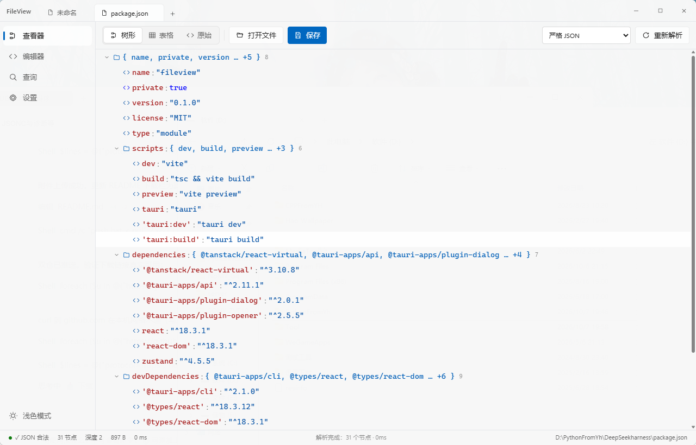

<div align="center">

# FileView

**Windows 11 Fluent 风格的多格式文件查看与编辑器**
**A Fluent-design multi-format file viewer & editor for Windows**


[功能](#-功能) · [界面](#-界面预览) · [格式](#-支持格式) · [下载](#-下载) · [开发](#-开发) · [许可证](#-许可证)

</div>

---

## 简介

FileView 是一款 Windows 桌面应用，采用 Notepad++ 的操作逻辑：**文档区恒为文本**，树形 / 表格 / 预览等查看能力收进右侧可关闭的「查看工具」面板，格式化等 JSON 专用操作集中在「格式化」菜单。
支持 JSON、Markdown、YAML、TOML、CSV、XML、HTML、INI、代码文件与日志的查看与编辑，
内置文档内查找、撤销 / 重做、JSONPath 查询，并可深度集成 Windows 资源管理器（右键菜单 / 文件关联 / 开机自启）。

> Windows 11 Fluent / WinUI 3 风格界面 · Tauri 2 (Rust) + React 18 + Vite + Tailwind CSS

## 🖼️ 界面预览

<p align="center">
  
</p>

## ✨ 功能

| 模块 | 说明 |
|---|---|
| **多格式查看** | JSON：树形（虚拟滚动）/ 表格（对象数组转表）/ 原始；Markdown：预览 / 源码；YAML·TOML：键结构 / 源码；CSV·TSV：表格（自动识别分隔符）；XML：标签树；HTML：沙箱预览；代码文件：符号大纲 / 源码；日志：级别与时间戳着色 |
| **面板化布局** | 文档区始终显示文本；查看工具 / JSONPath 查询 / 设置均为右侧可拖拽停靠面板，互不遮挡，Esc 一键关闭 |
| **查找与历史** | 文档内查找（Ctrl+F，Enter 跳转下一处、区分大小写）、撤销 / 重做（Ctrl+Z / Ctrl+Y，600ms 合并连续输入）|
| **语法高亮** | JSON / Markdown / YAML / TOML / CSV / XML / HTML / 日志 + 20+ 代码家族（JS·TS·Python·Rust·Go·Java·C#·C++…）关键字、类型、函数与内置常量着色 |
| **解析诊断** | 行列级错误定位、错误行高亮；严格 JSON / JSONC（注释、尾逗号）/ JSONL（逐行）|
| **查询** | JSONPath（`$.a.b[0]`、`[*]`、`..key`、`['key']`）+ 全文搜索（键/值，点击跳转树节点）|
| **编辑保存** | 文档区直接编辑；**Ctrl+S 保存**、Ctrl+Shift+S 另存为、格式化（2/4 空格/Tab）、压缩、键排序、字符串转义 / 反转义（均在「格式化」菜单）|
| **标签页** | 多标签编辑、脏标记（未保存 •）、空白页可删除、拖拽打开、文件变更自动重载 |
| **大文件** | 文档区虚拟滚动：只渲染可见行、只对可见区域做语法高亮，数十 MB 的文件也能流畅打开与滚动 |
| **系统集成** | 右键菜单「用 FileView 打开」、文件关联与默认应用注册、开机自启、一键清理（注册表无残留）|

## 📄 支持格式

| 类型 | 扩展名 | 视图 |
|---|---|---|
| JSON 家族 | `.json` `.jsonc` `.json5` `.jsonl` `.ndjson` `.har` `.geojson` `.webmanifest` | 树形 / 表格 / 原始 |
| Markdown | `.md` `.markdown` `.mdown` | 预览 / 源码 |
| 配置 | `.ini` `.cfg` `.conf` `.config` `.properties` `.env` `.yaml` `.yml` `.toml` | 结构 / 源码 |
| 数据 | `.csv` `.tsv` | 表格 |
| 标记语言 | `.xml` `.svg` `.html` `.htm` `.vue` `.svelte` | 结构 / 预览 |
| 代码 | `.js` `.ts` `.jsx` `.tsx` `.py` `.rs` `.go` `.java` `.cs` `.cpp` `.c` `.h` `.php` `.rb` `.sh` `.ps1` `.sql` `.css` 等 60+ 扩展名 | 大纲 / 源码 |
| 日志 / 文本 | `.log` `.txt` `.text` | 高亮文本 |

## 🖥️ 界面区域

| 区域 | 说明 |
|---|---|
| 文档区 | 始终显示当前文件文本：行号、语法高亮、当前行高亮、错误行标注，可直接编辑保存 |
| 查看工具面板 | 右侧停靠，按文件类型提供树形 / 表格 / 预览 / 结构 / 大纲 / 原始视图，可拖拽调宽 |
| 查询面板 | JSONPath 查询与全文搜索，点击结果定位到树节点 |
| 设置面板 | 外观、编辑器偏好、Windows 右键菜单 / 文件关联 / 开机自启 |

> 面板与文档区并存，打开设置不会遮挡正文，随时可关闭。

## 📥 下载

前往 **[Releases](https://github.com/OnlyHiu/FileView/releases)** 获取全部版本，最新版：

| 文件 | 说明 |
|---|---|
| [**FileView_0.2.0_x64_zh-CN.msi**](https://github.com/OnlyHiu/FileView/releases/latest/download/FileView_0.2.0_x64_zh-CN.msi) | MSI 安装包（简体中文，推荐）|
| [**FileView_0.2.0_x64_en-US.msi**](https://github.com/OnlyHiu/FileView/releases/latest/download/FileView_0.2.0_x64_en-US.msi) | MSI 安装包（英文）|
| [**fileview.exe**](https://github.com/OnlyHiu/FileView/releases/latest/download/fileview.exe) | 免安装单文件，双击即用 |

> 安装包使用 **Microsoft WiX Toolset** 官方工具链生成（MSI 格式）。
> 逐用户安装，**无需管理员权限**，默认安装到 `%LOCALAPPDATA%\Programs\FileView`。

> 安装后在设置页勾选扩展名即可注册右键菜单与文件关联。

## 🛠️ 开发

```bash
npm install          # 安装前端依赖
npm run tauri:dev    # 开发模式（Vite + Tauri 窗口）
npm run dev          # 仅浏览器预览（JS 降级解析）
```

测试与打包：

```bash
npm test                      # 前端纯逻辑测试（Node 内置 test runner）
cd src-tauri && cargo test    # Rust 单元测试（解析/格式化/JSONPath/注册表）
npm run tauri:build           # 打包 exe + MSI 安装包（WiX 官方工具链）
```

辅助脚本：

```bash
node scripts/check-ext-sync.mjs   # 前后端扩展名清单一致性校验
node scripts/check-csp.mjs        # 确认 CSP 已嵌入编译产物
node scripts/bench-highlight.mjs  # 大文件分词性能基准
```

> 依赖：Node 18+、Rust stable-msvc、VS Build Tools 2022（C++ 工作负载）、WebView2 运行时（Win11 自带）。
> Rust 测试中的注册表操作被重定向到 `HKCU\Software\FileViewTests` 沙箱，**不会影响系统设置**。

## 📁 项目结构

```
├── src/                    # 前端（React + Tailwind）
│   ├── components/ui.tsx   # WinUI 3 风格组件库
│   ├── features/           # 查看器视图、编辑器、查询、设置页
│   ├── stores/             # zustand 状态
│   └── lib/                # Tauri invoke 封装、类型、高亮（窗口化）
├── src-tauri/              # Rust 后端
│   ├── src/json_core/      # 解析 / 格式化 / JSONPath
│   ├── src/sys/            # 注册表、右键菜单、文件关联、自启
│   └── src/main.rs         # Tauri 命令层
├── scripts/                # 辅助脚本（图标生成、一致性校验、性能基准）
├── push.bat                # 一键推送到仓库
├── docs/DESIGN-PLAN.md     # 设计计划
├── docs/PLAN-v0.2.0.md      # v0.2.0 需求计划
├── docs/RELEASE-v0.2.0.md  # v0.2.0 发行说明
└── docs/AUDIT-v0.2.0.md    # v0.2.0 代码审核报告

## 🔗 系统集成实现说明

- 全部注册表写入走 **HKCU**（无需管理员）；写入清单记录于 `HKCU\Software\FileView\managed_keys`，
  卸载 /「一键清理」按清单精准回滚，保证无残留。
- 右键菜单：`HKCU\Software\Classes\*\shell\FileView` 等（位于 Windows 11「显示更多选项」经典菜单）。
- 文件关联：注册 ProgID（`HKCU\Software\Classes\FileView.json` 等）+ `OpenWithProgids` +
  Capabilities/RegisteredApplications；**不伪造 UserChoice**（Windows 哈希保护），
  通过 `ms-settings:defaultapps` 引导用户确认默认应用。
- **文件关联需用户显式勾选后注册**（首次启动不会自动抢占任何扩展名的默认处理程序）。
- 启动时按设置幂等注入系统集成，并自动迁移/清理旧品牌注册表痕迹（仅清理确属本应用旧版本的键）。
- 所有变更后调用 `SHChangeNotify(SHCNE_ASSOCCHANGED)` 即时刷新资源管理器；
  批量注册时只广播一次，避免 Explorer 反复重读。

## 🔒 安全

- 应用配置了**最小化 CSP**（`src-tauri/tauri.conf.json`）：脚本仅允许同源，
  `object-src` / `base-uri` / `form-action` 一律 `none`，
  唯一放行的额外来源是 Tauri 的 IPC 通道 `http://ipc.localhost`。
- Markdown 预览的 HTML 直通走**白名单**：仅保留明确允许的标签与属性，
  `script` / `iframe` / `object` / `meta` 等危险元素连同内容一并移除，
  URL 属性只允许 `http(s)` / `mailto` 等安全协议。
- HTML 预览在 `sandbox=""` 的 iframe 中渲染（无脚本、无表单、独立的 opaque origin）。

## ⚡ 性能

- **大文件虚拟滚动**：文档区只渲染可见行、只对可见区域做语法高亮，
  数十 MB 的文件也能流畅打开与滚动（此前会为每一行生成 DOM 节点并对全文分词）。
- **启动零 Shell 广播**：注册表写入操作全部幂等化，只有真正发生变更时才通知
  资源管理器，避免每次启动都让桌面图标闪烁。

## 📜 许可证

[MIT](LICENSE) © 2025 FileView Team
